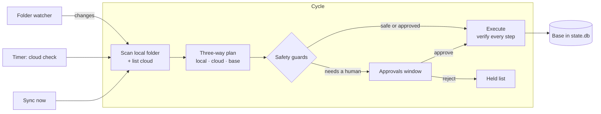

<p align="center">
  
</p>

<h1 align="center">WebDavSync</h1>

<p align="center">
  <b>Careful two-way sync between a Windows folder and a WebDAV cloud.</b><br>
  A small tray app and a command-line tool, built to replace the discontinued Mail.ru Cloud desktop client.
</p>

<p align="center">
  <a href="https://github.com/gray0072/webdav-sync/actions/workflows/ci.yml"></a>
  <a href="https://github.com/gray0072/webdav-sync/releases/latest"></a>
  <a href="LICENSE"></a>
  
  
</p>

<p align="center">
  <b>English</b> · <a href="README_ru.md">Русский</a> · <a href="README_sv.md">Svenska</a>
</p>

---

## Why

Most WebDAV clients either mount the cloud as a drive or copy files one way. WebDavSync keeps a **real local
folder** in sync with a cloud folder in **both directions**, like the desktop clients of the big clouds do — but it
works with any WebDAV server and puts safety first: it never "syncs the emptiness", never hard-deletes your files,
and asks before anything destructive.

It is used daily on a 415 GB / 43 700-file folder synced with Mail.ru Cloud.

## Features

- 🔁 **True two-way sync** — a three-way merge of local state, cloud state and the last synced state (the *base*).
  Edits, deletions, moves and renames on either side are carried over; conflicting edits keep **both** versions.
- 🛡️ **Safety first** — mass-delete guard, root-folder markers, deletions only of unchanged items, local deletes go
  to the Recycle Bin, no deletions at all during the first sync. See [Safety guarantees](#safety-guarantees).
- ✅ **You stay in control** — four modes from *DryRun* to *Auto*; an approvals window with checkboxes;
  "approve and remember" rules; rejected changes are *held* until the file changes again.
- 🖥️ **Tray app** — status icon, sync now, pause, approvals, folder selection; plus a full-featured CLI (`wds`).
- ⚡ **Efficient** — local changes re-list only the touched cloud folders; full cloud checks run on a schedule you
  choose; parallel listings; start-up trusts a fresh state instead of re-crawling.
- 📦 **Large files** — interrupted downloads resume with HTTP `Range`; dropped transfers are retried.
- 📁 **Selective sync** — choose which top-level folders are synced; excluding never deletes anything.
- 🔐 **Portable, passwords outside** — two `.exe` files and a `data` folder; passwords live in the Windows
  Credential Manager.
- 🪶 **Light on the machine** — background (low-priority) mode, optional CPU cap, hashing speed limit, and an optional
  *rolling verify* that re-hashes your files bit by bit to catch silent changes.
- ☁️ **Mail.ru ready** — imports the state of the old Mail.ru client (`.cloud.db`), so an existing folder is picked
  up without re-downloading anything; Mail.ru's content hashes are used for exact comparisons.

## How it works



Every cycle scans the local folder (size, time and file id; content hashes only where needed), lists the cloud
(fully, or only the folders that changed), and compares both with the base. The result is a plan: uploads,
downloads, moves, deletions, conflicts. Each operation re-checks both sides right before it runs, and the base is
updated only after the result is verified on the target side.

## Safety guarantees

1. A failed, partial or timed-out cloud listing is **never** read as "files were deleted".
2. An item is deleted on one side only if it is **unchanged** there since the last sync.
3. Local deletions and overwrites go to the **Recycle Bin**, never a hard delete.
4. The first sync of a folder is a **merge only** — nothing is deleted on either side.
5. **Mass-delete / mass-overwrite guard** in every mode, including *Auto*.
6. Both roots carry a marker (`.webdavsync/pair.json`): a missing or foreign root stops the pair instead of
   "syncing the emptiness". (That is the `.webdavsync` folder you see in the cloud.)
7. Downloads go to a temporary file and are moved into place atomically.
8. Excluding a folder never deletes anything; including it again merges without deletions.
9. A file whose content changed while its size and time did not (an edit that kept the time, or disk corruption)
   always needs your approval.

## Requirements

- Windows 10 or 11 (x64)
- [.NET 10 Desktop Runtime](https://dotnet.microsoft.com/download/dotnet/10.0)
- A WebDAV account. For **Mail.ru Cloud**: an app password (Mail.ru account → *Security* → *Passwords for external
  applications*), endpoint `https://webdav.cloud.mail.ru/`.

## Install

1. Download `WebDavSync-<version>-win-x64.zip` from [Releases](https://github.com/gray0072/webdav-sync/releases/latest).
2. Unpack it into a **writable** folder, e.g. `D:\Apps\WebDavSync` (not `Program Files`).

That's it — the folder is portable: `WebDavSync.exe` (tray), `wds.exe` (CLI) and a `data\` folder created next to them.

## Quick start

```powershell
cd D:\Apps\WebDavSync

# 1. Check the account and detect what the server supports (Mail.ru: content hashes in getetag)
$env:WDS_PASSWORD = '<app password>'
.\wds.exe probe --url https://webdav.cloud.mail.ru/ --user you@mail.ru

# 2. Create a pair: local folder <-> cloud folder
#    (--import-legacy picks up the old Mail.ru client's state from D:\Cloud\.cloud.db)
.\wds.exe pair add --name cloud --local D:\Cloud --url https://webdav.cloud.mail.ru/ --remote-root / --user you@mail.ru --mode ApproveAll

# 3. Store the password in the Windows Credential Manager (hidden prompt)
.\wds.exe secret set cloud

# 4. See what would happen — nothing is changed
.\wds.exe plan cloud

# 5. Start the tray app
.\WebDavSync.exe
```

In *ApproveAll* mode every change waits in the **Approvals** window (click the tray icon). Once you trust it, switch
the mode in *Settings ▸ Mode* to *Guarded* (only deletions, overwrites and conflicts ask) or *Auto*.

## Modes

| Mode | What runs without asking |
|---|---|
| `DryRun` | Nothing — plans are only shown. |
| `ApproveAll` | Nothing — every plan waits for approval. |
| `Guarded` | New files and folders in both directions; deletions, overwrites, moves and conflicts wait. |
| `Auto` | Everything, except safety-guard trips and silent content changes. |

The first sync of a pair always waits for approval, in any mode.
Rules (`wds rule add cloud --type Download --folder "Camera Uploads"`) approve matching operations automatically.

## The tray app

| Icon | Meaning |
|---|---|
| Blue cloud | Up to date, or quietly checking for changes |
| Pulsing cloud | Transferring files |
| Yellow badge | Something needs your approval, or some items failed |
| Red badge | Error (e.g. wrong password) |
| Grey cloud | Offline or paused |

Menu: *Open folder* · *Open cloud in browser* · *Sync now* · *Pause* (15 min, 1 h, until tomorrow, until resumed) ·
*Approvals* · *Choose folders* · *Settings* (mode, cloud check interval, local verify, hashing speed, password) ·
*Performance* (low priority, CPU limit) · *Start with Windows* · *Open log folder* · *About*.

## Command line

| Command | Purpose |
|---|---|
| `wds probe --url <url> --user <login>` | Check the account and detect server capabilities |
| `wds pair add` / `pair list` / `pair show <pair>` | Create and inspect pairs |
| `wds pair set <pair> name=value …` | Change settings, e.g. `mode=Guarded remotePollInterval=1h` |
| `wds secret set <pair>` / `secret remove <pair>` | Store or remove the password (Credential Manager) |
| `wds plan <pair>` | Show the plan without changing anything |
| `wds sync <pair> --once` | Run one cycle with console approval |
| `wds folders <pair> [--exclude X] [--include X]` | Choose the top-level folders to sync |
| `wds held <pair> [--release <path>] [--all]` | List or release held (rejected) operations |
| `wds rule list\|add\|remove <pair>` | Auto-approve rules |
| `wds status <pair>` | State of the pair |

Run `wds <command> --help` for all options.

## Settings

Settings live in `data\settings.json`; change them from the tray or with `wds pair set`. The most useful ones:

| Setting | Default | |
|---|---|---|
| `mode` | `ApproveAll` | See [Modes](#modes) |
| `remotePollInterval` | `15m` | How often the whole cloud is checked; local changes are picked up within seconds |
| `maxOpsPerCycle` | none | Execute at most N operations per cycle (handy for first runs) |
| `massDeleteCount` / `massDeletePercent` | `50` / `5` | Mass-delete guard thresholds |
| `conflictWinner` | `Local` | Which version keeps the original name in a conflict |
| `localVerifyInterval` | off | Rolling verify: re-hash every local file once per period |
| `hashLimitMBps` | unlimited | Read speed of hashing |
| `maxRequestsPerSecond` / `maxParallelRequests` | `5` / `4` | Load on the WebDAV server |

The full list is in [spec §15.5](spec/15-config-storage.md).

## Where things are stored

| What | Where |
|---|---|
| Settings, logs | `<app folder>\data\` |
| Passwords | Windows Credential Manager, `WebDavSync/<pair id>` |
| Sync state (base, journal, backups, partial downloads) | `<synced folder>\.webdavsync\` (hidden, never synced) |
| Root marker in the cloud | `<cloud folder>/.webdavsync/pair.json` |

## Build from source

```powershell
git clone https://github.com/gray0072/webdav-sync.git
cd webdav-sync
dotnet build
dotnet test --project tests/WebDavSync.Core.Tests
.\scripts\publish.ps1 -Output D:\Apps\WebDavSync     # portable single-file build
```

Requires the .NET 10 SDK. Integration tests run against `rclone serve webdav` in Docker and are skipped without it.
The design is described in detail in [spec/](spec/README.md); contributors start with [AGENTS.md](AGENTS.md).

## Status

Version 0.1 — in daily use, but young. Planned next: activity, conflicts and errors windows, a settings window,
upload/download bandwidth limits, Windows toast notifications. Ideas and bug reports are welcome in
[Issues](https://github.com/gray0072/webdav-sync/issues).

## License

[MIT](LICENSE) © 2026 Sergey Ilyin
