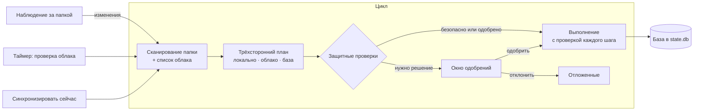

<p align="center">
  
</p>

<h1 align="center">WebDavSync</h1>

<p align="center">
  <b>Аккуратная двусторонняя синхронизация папки Windows с облаком WebDAV.</b><br>
  Небольшое приложение в трее и утилита командной строки — замена закрытому десктопному клиенту Облака Mail.ru.
</p>

<p align="center">
  <a href="https://github.com/gray0072/webdav-sync/actions/workflows/ci.yml"></a>
  <a href="https://github.com/gray0072/webdav-sync/releases/latest"></a>
  <a href="LICENSE"></a>
  
  
</p>

<p align="center">
  <a href="README.md">English</a> · <b>Русский</b> · <a href="README_sv.md">Svenska</a>
</p>

---

## Зачем

Большинство WebDAV-клиентов либо подключают облако как диск, либо копируют файлы в одну сторону. WebDavSync держит
**настоящую локальную папку** синхронной с папкой в облаке **в обе стороны** — как это делают клиенты больших облаков, —
но работает с любым WebDAV-сервером и ставит безопасность на первое место: никогда не «синхронизирует пустоту», никогда
не удаляет файлы безвозвратно и спрашивает перед любым разрушительным действием.

Используется каждый день на папке 415 ГБ / 43 700 файлов, синхронизированной с Облаком Mail.ru.

## Возможности

- 🔁 **Настоящая двусторонняя синхронизация** — трёхстороннее сравнение: локальное состояние, облако и состояние
  последней синхронизации (*база*). Правки, удаления, перемещения и переименования с любой стороны переносятся;
  при конфликте правок сохраняются **обе** версии.
- 🛡️ **Безопасность прежде всего** — защита от массового удаления, маркеры корневых папок, удаляется только то, что не
  менялось, локальные удаления идут в Корзину, при первой синхронизации не удаляется ничего.
  См. [Гарантии безопасности](#гарантии-безопасности).
- ✅ **Всё под контролем** — четыре режима от *DryRun* до *Auto*; окно одобрений с галочками; правила
  «одобрить и запомнить»; отклонённые изменения *откладываются*, пока файл снова не изменится.
- 🖥️ **Приложение в трее** — значок состояния, «синхронизировать сейчас», пауза, одобрения, выбор папок; плюс полноценная
  утилита командной строки (`wds`).
- ⚡ **Экономно** — при локальных изменениях заново читаются только затронутые папки облака; полная проверка облака —
  по выбранному вами расписанию; параллельные запросы; при запуске свежему состоянию доверяют, а не обходят облако заново.
- 📦 **Большие файлы** — прерванные скачивания докачиваются через HTTP `Range`; оборванные передачи повторяются.
- 📁 **Выборочная синхронизация** — выбор папок первого уровня; исключение папки никогда ничего не удаляет.
- 🔐 **Портабельно, пароли отдельно** — два `.exe` и папка `data`; пароли хранятся в Диспетчере учётных данных Windows.
- 🪶 **Бережно к компьютеру** — фоновый режим с низким приоритетом, лимит CPU, ограничение скорости хэширования и
  необязательная *скользящая проверка*, которая понемногу перехэширует файлы, чтобы поймать незаметные изменения.
- ☁️ **Готово для Mail.ru** — импортирует состояние старого клиента Mail.ru (`.cloud.db`), поэтому существующая папка
  подхватывается без повторного скачивания; для точного сравнения используются хэши содержимого Mail.ru.

## Как это работает



Каждый цикл сканирует локальную папку (размер, время, идентификатор файла; хэши — только где нужно), получает список
облака (полностью или только изменившиеся папки) и сравнивает обе стороны с базой. Получается план: загрузки,
скачивания, перемещения, удаления, конфликты. Перед выполнением каждая операция заново проверяет обе стороны, а база
обновляется только после того, как результат подтверждён на целевой стороне.

## Гарантии безопасности

1. Неудачный, неполный или прерванный по таймауту список облака **никогда** не считается удалением файлов.
2. Элемент удаляется на одной стороне, только если он там **не менялся** с последней синхронизации.
3. Локальные удаления и перезаписи уходят в **Корзину**, а не удаляются безвозвратно.
4. Первая синхронизация папки — **только слияние**: ни на одной стороне ничего не удаляется.
5. **Защита от массового удаления и перезаписи** во всех режимах, включая *Auto*.
6. В обоих корнях лежит маркер (`.webdavsync/pair.json`): пропавший или чужой корень останавливает пару, а не
   «синхронизирует пустоту». (Это та самая папка `.webdavsync`, которую видно в облаке.)
7. Скачивание идёт во временный файл, который затем атомарно переносится на место.
8. Исключение папки ничего не удаляет; повторное включение — слияние без удалений.
9. Файл, у которого изменилось содержимое, а размер и время — нет (правка с сохранением даты или порча диска), всегда
   требует вашего одобрения.

## Требования

- Windows 10 или 11 (x64)
- [.NET 10 Desktop Runtime](https://dotnet.microsoft.com/download/dotnet/10.0)
- Аккаунт WebDAV. Для **Облака Mail.ru**: пароль для внешнего приложения (аккаунт Mail.ru → *Безопасность* →
  *Пароли для внешних приложений*), адрес `https://webdav.cloud.mail.ru/`.

## Установка

1. Скачайте `WebDavSync-<версия>-win-x64.zip` со страницы [Releases](https://github.com/gray0072/webdav-sync/releases/latest).
2. Распакуйте в папку, **доступную для записи**, например `D:\Apps\WebDavSync` (не в `Program Files`).

Всё — папка портабельная: `WebDavSync.exe` (трей), `wds.exe` (командная строка) и создаваемая рядом папка `data\`.

## Быстрый старт

```powershell
cd D:\Apps\WebDavSync

# 1. Проверить аккаунт и возможности сервера (Mail.ru: хэши содержимого в getetag)
$env:WDS_PASSWORD = '<пароль приложения>'
.\wds.exe probe --url https://webdav.cloud.mail.ru/ --user you@mail.ru

# 2. Создать пару: локальная папка <-> папка в облаке
#    (--import-legacy подхватит состояние старого клиента Mail.ru из D:\Cloud\.cloud.db)
.\wds.exe pair add --name cloud --local D:\Cloud --url https://webdav.cloud.mail.ru/ --remote-root / --user you@mail.ru --mode ApproveAll

# 3. Сохранить пароль в Диспетчере учётных данных Windows (ввод скрыт)
.\wds.exe secret set cloud

# 4. Посмотреть, что будет сделано, — ничего не меняется
.\wds.exe plan cloud

# 5. Запустить приложение в трее
.\WebDavSync.exe
```

В режиме *ApproveAll* каждое изменение ждёт в окне **Approvals** (клик по значку в трее). Когда освоитесь, переключите
режим в *Settings ▸ Mode* на *Guarded* (спрашиваются только удаления, перезаписи и конфликты) или *Auto*.

## Режимы

| Режим | Что выполняется без вопросов |
|---|---|
| `DryRun` | Ничего — планы только показываются. |
| `ApproveAll` | Ничего — каждый план ждёт одобрения. |
| `Guarded` | Новые файлы и папки в обе стороны; удаления, перезаписи, перемещения и конфликты ждут. |
| `Auto` | Всё, кроме срабатываний защиты и незаметных изменений содержимого. |

Первая синхронизация пары всегда ждёт одобрения, в любом режиме.
Правила (`wds rule add cloud --type Download --folder "Camera Uploads"`) автоматически одобряют подходящие операции.

## Приложение в трее

| Значок | Значение |
|---|---|
| Синее облако | Всё синхронизировано или идёт тихая проверка |
| Пульсирующее облако | Передаются файлы |
| Жёлтая метка | Нужно ваше одобрение или часть файлов не удалось обработать |
| Красная метка | Ошибка (например, неверный пароль) |
| Серое облако | Нет сети или пауза |

Меню: *Open folder* · *Open cloud in browser* · *Sync now* · *Pause* (15 мин, 1 ч, до завтра, до снятия) ·
*Approvals* · *Choose folders* · *Settings* (режим, период проверки облака, проверка локальных файлов, скорость
хэширования, пароль) · *Performance* (низкий приоритет, лимит CPU) · *Start with Windows* · *Open log folder* · *About*.

## Командная строка

| Команда | Назначение |
|---|---|
| `wds probe --url <url> --user <логин>` | Проверить аккаунт и возможности сервера |
| `wds pair add` / `pair list` / `pair show <пара>` | Создать и посмотреть пары |
| `wds pair set <пара> имя=значение …` | Изменить настройки, например `mode=Guarded remotePollInterval=1h` |
| `wds secret set <пара>` / `secret remove <пара>` | Сохранить или удалить пароль (Диспетчер учётных данных) |
| `wds plan <пара>` | Показать план, ничего не меняя |
| `wds sync <пара> --once` | Один цикл с одобрением в консоли |
| `wds folders <пара> [--exclude X] [--include X]` | Выбрать папки первого уровня |
| `wds held <пара> [--release <путь>] [--all]` | Показать или вернуть отложенные операции |
| `wds rule list\|add\|remove <пара>` | Правила автоодобрения |
| `wds status <пара>` | Состояние пары |

Все параметры: `wds <команда> --help`.

## Настройки

Настройки хранятся в `data\settings.json`; меняются из трея или командой `wds pair set`. Самые полезные:

| Настройка | По умолчанию | |
|---|---|---|
| `mode` | `ApproveAll` | См. [Режимы](#режимы) |
| `remotePollInterval` | `15m` | Как часто проверяется всё облако; локальные изменения подхватываются за секунды |
| `maxOpsPerCycle` | нет | Не больше N операций за цикл (удобно на первых запусках) |
| `massDeleteCount` / `massDeletePercent` | `50` / `5` | Пороги защиты от массового удаления |
| `conflictWinner` | `Local` | Какая версия сохраняет исходное имя при конфликте |
| `localVerifyInterval` | выкл. | Скользящая проверка: каждый файл перехэшируется раз в период |
| `hashLimitMBps` | без ограничения | Скорость чтения при хэшировании |
| `maxRequestsPerSecond` / `maxParallelRequests` | `5` / `4` | Нагрузка на WebDAV-сервер |

Полный список — в [спецификации, §15.5](spec/15-config-storage.md).

## Где что хранится

| Что | Где |
|---|---|
| Настройки, логи | `<папка программы>\data\` |
| Пароли | Диспетчер учётных данных Windows, `WebDavSync/<id пары>` |
| Состояние синхронизации (база, журнал, резервные копии, недокачанные файлы) | `<синхронизируемая папка>\.webdavsync\` (скрыта, не синхронизируется) |
| Маркер корня в облаке | `<папка в облаке>/.webdavsync/pair.json` |

## Сборка из исходников

```powershell
git clone https://github.com/gray0072/webdav-sync.git
cd webdav-sync
dotnet build
dotnet test --project tests/WebDavSync.Core.Tests
.\scripts\publish.ps1 -Output D:\Apps\WebDavSync     # портабельная однофайловая сборка
```

Нужен .NET 10 SDK. Интеграционные тесты работают с `rclone serve webdav` в Docker и без него пропускаются.
Устройство программы подробно описано в [spec/](spec/README.md) (на английском); для разработчиков — [AGENTS.md](AGENTS.md).

## Состояние

Версия 0.1 — в ежедневном использовании, но проект молодой. Дальше в планах: окна активности, конфликтов и ошибок,
окно настроек, ограничение скорости загрузки и скачивания, уведомления Windows. Идеи и сообщения об ошибках —
в [Issues](https://github.com/gray0072/webdav-sync/issues).

## Лицензия

[MIT](LICENSE) © 2026 Sergey Ilyin
