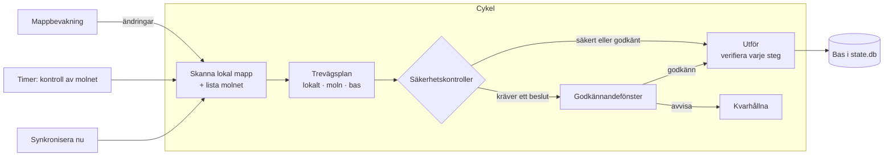

<p align="center">
  
</p>

<h1 align="center">WebDavSync</h1>

<p align="center">
  <b>Noggrann tvåvägssynkronisering mellan en Windows-mapp och ett WebDAV-moln.</b><br>
  En liten app i aktivitetsfältet och ett kommandoradsverktyg, byggda för att ersätta den nedlagda skrivbordsklienten för Mail.ru Cloud.
</p>

<p align="center">
  <a href="https://github.com/gray0072/webdav-sync/actions/workflows/ci.yml"></a>
  <a href="https://github.com/gray0072/webdav-sync/releases/latest"></a>
  <a href="LICENSE"></a>
  
  
</p>

<p align="center">
  <a href="README.md">English</a> · <a href="README_ru.md">Русский</a> · <b>Svenska</b>
</p>

---

## Varför

De flesta WebDAV-klienter monterar antingen molnet som en enhet eller kopierar filer åt ett håll. WebDavSync håller en
**riktig lokal mapp** synkroniserad med en mapp i molnet **i båda riktningarna**, så som de stora molntjänsternas
skrivbordsklienter gör — men fungerar med vilken WebDAV-server som helst och sätter säkerheten först: den
"synkroniserar aldrig tomheten", raderar aldrig dina filer permanent och frågar innan något destruktivt händer.

Den används dagligen på en mapp med 415 GB / 43 700 filer som synkroniseras med Mail.ru Cloud.

## Funktioner

- 🔁 **Äkta tvåvägssynkronisering** — en trevägsjämförelse av lokalt läge, molnläge och läget vid senaste
  synkroniseringen (*basen*). Ändringar, raderingar, flyttar och namnbyten på båda sidor förs över; vid konflikter
  sparas **båda** versionerna.
- 🛡️ **Säkerhet först** — skydd mot massradering, markörer i rotmapparna, endast oförändrade objekt raderas, lokala
  raderingar hamnar i Papperskorgen och vid första synkroniseringen raderas ingenting. Se [Säkerhetsgarantier](#säkerhetsgarantier).
- ✅ **Du har kontrollen** — fyra lägen från *DryRun* till *Auto*; ett godkännandefönster med kryssrutor; regler för
  "godkänn och kom ihåg"; avvisade ändringar *hålls kvar* tills filen ändras igen.
- 🖥️ **App i aktivitetsfältet** — installationsguide, statusikon, synkronisera nu, paus, godkännanden, val av mappar;
  plus ett kommandoradsverktyg för avancerad användning.
- ⚡ **Effektiv** — vid lokala ändringar listas bara de berörda molnmapparna om; hela molnet kontrolleras enligt ett
  schema du väljer; parallella förfrågningar; vid start litar den på ett färskt läge i stället för att gå igenom allt igen.
- 📦 **Stora filer** — avbrutna nedladdningar återupptas med HTTP `Range`; avbrutna överföringar görs om.
- 📁 **Selektiv synkronisering** — välj vilka mappar på översta nivån som synkroniseras; att utesluta en mapp raderar aldrig något.
- 🔐 **Portabel, lösenord utanför** — en `.exe`-fil och en `data`-mapp; lösenorden lagras i Windows Autentiseringshanteraren.
- 🪶 **Skonsam mot datorn** — bakgrundsläge med låg prioritet, valfritt CPU-tak, hastighetsgräns för hashning och en
  valfri *rullande kontroll* som hashar om filerna bit för bit för att upptäcka tysta ändringar.
- ☁️ **Redo för Mail.ru** — importerar läget från den gamla Mail.ru-klienten (`.cloud.db`), så en befintlig mapp tas
  över utan att något laddas ned igen; Mail.ru:s innehållshashar används för exakta jämförelser.

## Så fungerar det



Varje cykel skannar den lokala mappen (storlek, tid och fil-id; innehållshashar bara där det behövs), listar molnet
(helt, eller bara de mappar som ändrats) och jämför båda med basen. Resultatet är en plan: uppladdningar,
nedladdningar, flyttar, raderingar, konflikter. Varje åtgärd kontrollerar båda sidor igen precis innan den körs, och
basen uppdateras först när resultatet är verifierat på målsidan.

## Säkerhetsgarantier

1. En misslyckad, ofullständig eller tidsgränsad listning av molnet tolkas **aldrig** som att filer har raderats.
2. Ett objekt raderas på en sida bara om det är **oförändrat** där sedan senaste synkroniseringen.
3. Lokala raderingar och överskrivningar hamnar i **Papperskorgen**, aldrig permanent radering.
4. Första synkroniseringen av en mapp är **bara en sammanslagning** — ingenting raderas på någon sida.
5. **Skydd mot massradering och massöverskrivning** i alla lägen, även *Auto*.
6. Båda rötterna har en markör (`.webdavsync/pair.json`): en saknad eller främmande rot stoppar paret i stället för att
   "synkronisera tomheten". (Det är mappen `.webdavsync` som syns i molnet.)
7. Nedladdningar går till en tillfällig fil som sedan flyttas på plats atomärt.
8. Att utesluta en mapp raderar aldrig något; att ta med den igen slår ihop sidorna utan raderingar.
9. En fil vars innehåll ändrats medan storlek och tid är desamma (en ändring som behöll tiden, eller diskfel) kräver
   alltid ditt godkännande.

## Krav

- Windows 10 eller 11 (x64)
- [.NET 10 Desktop Runtime](https://dotnet.microsoft.com/download/dotnet/10.0)
- Ett WebDAV-konto. För **Mail.ru Cloud**: ett applösenord (Mail.ru-konto → *Säkerhet* → *Lösenord för externa
  appar*), adress `https://webdav.cloud.mail.ru/`. Ge applösenordet **full åtkomst ("Mail, Cloud and Calendar")**:
  då läses hela molnet med en enda begäran och ändringar i molnet märks inom en minut. Ett applösenord bara för
  WebDAV fungerar också, men långsammare (molnet läses mapp för mapp och kontrolleras var 15:e minut).

## Installation

1. Ladda ned `WebDavSync-<version>-win-x64.zip` från [Releases](https://github.com/gray0072/webdav-sync/releases/latest).
2. Packa upp den i en **skrivbar** mapp, t.ex. `D:\Apps\WebDavSync` (inte `Program Files`).
3. Starta `WebDavSync.exe`.

Mappen är portabel: inställningar och loggar sparas i en `data\`-mapp bredvid programmet. En ny version som packas upp
i en annan mapp tar vid första starten över inställningarna från den kopia som kördes senast (och flyttar *Start with
Windows* till sig själv); lösenord och synkläge ligger inte i programmappen, så inget behöver ställas in igen.

## Kom igång

Vid första starten öppnas en kort guide:

1. **Anslut ditt moln** — välj *Mail.ru Cloud* (eller en annan WebDAV-server), ange inloggning och ett
   **applösenord**. Guiden kontrollerar anslutningen direkt.
2. **Välj mapparna** — en mapp på datorn och en mapp i molnet (*Browse…* visar molnets mappar). Guiden förklarar vad
   som kommer att hända:
   - en mapp som den gamla Mail.ru Cloud-appen använde **tas över** — bara skillnaderna synkroniseras;
   - en mapp som WebDavSync redan har synkroniserat (t.ex. efter att appen flyttats) **fortsätter med sitt läge**;
   - filer som redan finns i mappen **slås ihop** med molnet — ingenting raderas på någon sida.
3. **Hur försiktig ska den vara?** — *fråga före varje ändring* (rekommenderas i början), *fråga bara innan något
   raderas, skrivs över eller flyttas*, eller *synkronisera allt själv*; och om den ska starta med Windows.

Sedan visas molnikonen bredvid klockan. Första kontrollen av molnet tar några minuter; därefter plockas ändringar upp
inom sekunder. I det försiktiga läget klickar du på ikonen för att se och godkänna ändringarna.

Fler mappar: *Add a folder…* i menyn. Bara en kopia av appen körs åt gången.

## Lägen

| Läge | Vad körs utan att fråga |
|---|---|
| `DryRun` | Ingenting — planer visas bara. |
| `ApproveAll` | Ingenting — varje plan väntar på godkännande. |
| `Guarded` | Nya filer och mappar åt båda hållen; raderingar, överskrivningar, flyttar och konflikter väntar. |
| `Auto` | Allt, utom utlösta säkerhetskontroller och tysta innehållsändringar. |

Första synkroniseringen av ett par väntar alltid på godkännande, i alla lägen.
Regler (`wds rule add cloud --type Download --folder "Camera Uploads"`) godkänner matchande åtgärder automatiskt.

## Appen i aktivitetsfältet

| Ikon | Betydelse |
|---|---|
| Blått moln | Allt är synkroniserat, eller en tyst kontroll pågår |
| Pulserande moln | Filer överförs |
| Gul markering | Något väntar på ditt godkännande, eller några filer misslyckades |
| Röd markering | Fel (t.ex. fel lösenord) |
| Grått moln | Offline eller pausad |

Menyn börjar med versionen och dess utgivningsdatum. Meny: *Open folder* · *Open cloud in browser* · *Sync now* · *Pause* (15 min, 1 h, till i morgon, tills vidare) ·
*Approvals* · *Choose folders* · *Settings* (läge, intervall för molnkontroll, lokal kontroll, hashningshastighet,
lösenord) · *Performance* (låg prioritet, CPU-tak) · *Start with Windows* · *Updates* (sök nu; sök automatiskt varje dag,
vecka, månad eller aldrig — dagligen som standard) · *Open log folder* · *WebDavSync on GitHub*.

Nya versioner hittas automatiskt: *Update to X…* i menyn visar vad som är nytt och installerar med ett klick
(nedladdningen kontrolleras mot sin SHA-256-kontrollsumma; inställningar och synkläge behålls).

## Kommandoraden (avancerat)

Nedladdningen innehåller bara appen. Kommandoradsverktyget `wds.exe` byggs från källkoden tillsammans med den
(`scripts\publish.ps1`, se [Bygga från källkod](#bygga-från-källkod)) och använder samma `data\`-mapp; det är
praktiskt för skript, felsökning och de första cyklerna för en stor mapp.

| Kommando | Syfte |
|---|---|
| `wds probe --url <url> --user <inloggning>` | Kontrollera kontot och serverns funktioner |
| `wds pair add` / `pair list` / `pair show <par>` | Skapa och visa par |
| `wds pair set <par> namn=värde …` | Ändra inställningar, t.ex. `mode=Guarded remotePollInterval=1h` |
| `wds secret set <par>` / `secret remove <par>` | Spara eller ta bort lösenordet (Autentiseringshanteraren) |
| `wds plan <par>` | Visa planen utan att ändra något |
| `wds sync <par> --once` | Kör en cykel med godkännande i konsolen |
| `wds folders <par> [--exclude X] [--include X]` | Välj mappar på översta nivån |
| `wds held <par> [--release <sökväg>] [--all]` | Visa eller släpp kvarhållna åtgärder |
| `wds rule list\|add\|remove <par>` | Regler för automatiskt godkännande |
| `wds status <par>` | Parets läge |
| `wds crawl <par> [--compare]` | Läs molnsidan som en synkcykel gör (ändrar inget); Mail.ru: jämför med en läsning mapp för mapp över WebDAV |

Alla alternativ: `wds <kommando> --help`.

## Inställningar

Inställningarna finns i `data\settings.json`; ändra dem från aktivitetsfältet eller med `wds pair set`. De mest användbara:

| Inställning | Standard | |
|---|---|---|
| `mode` | `ApproveAll` | Se [Lägen](#lägen) |
| `remotePollInterval` | `15m` | Hur ofta hela molnet kontrolleras; lokala ändringar plockas upp inom sekunder |
| `remoteCheckInterval` | `1m` | Mail.ru med ett applösenord med full åtkomst: hur ofta molnet tillfrågas om något har ändrats (en liten begäran) |
| `useMailRuApi` | `true` | Mail.ru: läs molnet med Mail.ru-API:t när applösenordet tillåter det; `false` = bara WebDAV |
| `maxOpsPerCycle` | ingen | Högst N åtgärder per cykel (praktiskt de första gångerna) |
| `massDeleteCount` / `massDeletePercent` | `50` / `5` | Gränser för skyddet mot massradering |
| `conflictWinner` | `Local` | Vilken version som behåller originalnamnet vid en konflikt |
| `localVerifyInterval` | av | Rullande kontroll: varje lokal fil hashas om en gång per period |
| `hashLimitMBps` | obegränsad | Läshastighet vid hashning |
| `maxRequestsPerSecond` / `maxParallelRequests` | `5` / `4` | Belastning på WebDAV-servern |

Hela listan finns i [specifikationen, §15.5](spec/15-config-storage.md).

## Var saker lagras

| Vad | Var |
|---|---|
| Inställningar, loggar | `<appmapp>\data\` |
| Lösenord | Windows Autentiseringshanteraren, `WebDavSync/<par-id>` |
| Synkroniseringsläge (bas, journal, säkerhetskopior, ofullständiga nedladdningar) | `<synkad mapp>\.webdavsync\` (dold, synkroniseras aldrig) |
| Rotmarkör i molnet | `<molnmapp>/.webdavsync/pair.json` |

## Bygga från källkod

```powershell
git clone https://github.com/gray0072/webdav-sync.git
cd webdav-sync
dotnet build
dotnet test --project tests/WebDavSync.Core.Tests
.\scripts\publish.ps1 -Output D:\Apps\WebDavSync     # portabelt bygge: WebDavSync.exe + wds.exe
```

Kräver .NET 10 SDK. Integrationstesterna körs mot `rclone serve webdav` i Docker och hoppas över utan det.
Konstruktionen beskrivs i detalj i [spec/](spec/README.md) (på engelska); för utvecklare finns [AGENTS.md](AGENTS.md).

## Status

Version 0.1 — används dagligen, men projektet är ungt. Planerat härnäst: fönster för aktivitet, konflikter och fel,
ett inställningsfönster, bandbreddsgränser för upp- och nedladdning, Windows-aviseringar. Idéer och felrapporter
tas gärna emot under [Issues](https://github.com/gray0072/webdav-sync/issues).

## Licens

[MIT](LICENSE) © 2026 Sergey Ilyin
